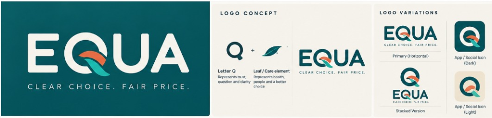

# 🌿 EQUA — Equal Medicine, Explained

> **"Clear Choice. Fair Price."**  
> Making affordable medicines feel like an informed choice rather than a compromise.



---

## 📖 About EQUA

People don’t doubt generics because they’ve seen proof against them. They doubt them because no one has shown them proof for them. In that silence, a low price reads as low quality, and many patients—and some doctors—don’t know how generics are approved, made, or tested.

**EQUA’s role is to fill that silence through communication:**
- Explaining in plain words what a generic is, how it is approved, made, and tested, and why it costs less.
- It does not ask for blind trust—it provides people what they need to form confidence themselves.
- It keeps the doctor firmly in the conversation.

### Tone and Voice
- **Calm, patient, and plain-spoken**—like a pharmacist explaining things to an elderly parent without talking down.
- **Regional-language first**, short sentences, no medical jargon.
- **Never the words “cheap” or “compromise”**—we believe in *fair price*, not inferior quality.

---

## 🏛️ The Three Pillars of EQUA

1. **Equality (Same Active Molecule)**:  
   A molecule of Paracetamol, Atorvastatin, or Telmisartan has the exact same atomic bonds regardless of the brand name printed on the box. When patents expire, the formula belongs to public health.
2. **Fairness (The Price Difference Explained Openly)**:  
   The price difference is unbundled transparently: no 20-year-old expired patents, TV campaigns, or sales-rep gifts. Only honest manufacturing, strict quality checks, and fair pharmacy distribution.
3. **Balance (Patient, Pharmacist, & Doctor in Harmony)**:  
   Patient, pharmacist, and doctor each have a respected role. We empower patients with constructive questions to bring directly to their physician.

---

## ✨ Features on the Webpage

- **Interactive Molecular Pill Breakdown**: Side-by-side comparison of an originator brand tablet vs. EQUA Equal Generic with bioequivalence metrics.
- **Interactive Bioequivalence Absorption Canvas**: Live pharmacokinetics graph illustrating blood concentration ($C_{\max}$, $\text{AUC}$) matching the originator inside the strict 80%–125% CDSCO & US-FDA regulatory envelope.
- **The Honest Math & Household Savings Slider**: Interactive calculator showing where every ₹100 goes, plus 1-year and 5-year family savings.
- **Searchable Medicine Index**: Search and filter chronic & everyday medications (Blood Pressure, Diabetes, Cholesterol, Acidity, Pain Relief) with transparent strip pricing.
- **Doctor Discussion Slip Generator**: Patients can select medicines and generate a printable, respectful consultation card to bring to their clinic appointment.
- **Regional Language Toggle**: English and Hindi (**हिन्दी**) language switchers to honor the regional-first principle.
- **The Pharmacist’s Desk (FAQ)**: Plain-spoken answers to common doubts (color/shape differences, factory safety, chronic disease efficacy).
- **No Login Required**: 100% accessible to every patient, family, and doctor.

---

## 🚀 Live Demo & Deployment

This project is built with zero-build pure web standards (HTML5, Tailwind CSS, vanilla JavaScript, SVG). It can be hosted immediately on **GitHub Pages** for free.

### Running Locally
To preview locally:
```bash
# Python 3
python3 -m http.server 8080

# Or Node.js (npx)
npx serve .
```
Then open [http://localhost:8080](http://localhost:8080) in your web browser.

---

## 🌐 Deploying to GitHub Pages (Step-by-Step)

1. **Push this repository to GitHub** (see instructions below).
2. Go to your repository on GitHub.
3. Click on **Settings** > **Pages** (under "Code and automation" in the left sidebar).
4. Under **Build and deployment** > **Source**, choose **Deploy from a branch**.
5. Select branch **`main`** and folder **`/ (root)`**, then click **Save**.
6. Within ~60 seconds, your site will be live at:
   ```
   https://abheerdhanani.github.io/equa-health/
   ```

---

## 📁 Repository Structure

```
├── index.html            # Main semantic landing page
├── styles.css            # Custom brand styles & print stylesheet
├── app.js                # Search, calculator, bioequivalence chart, modal logic
├── assets/
│   ├── brand-board.png   # Official EQUA brand identity guidelines
│   ├── logo.svg          # Primary vector logo (Teal + Coral/Aqua leaf)
│   ├── logo-white.svg    # White vector logo for dark backgrounds
│   └── logo-icon.svg     # Standalone Q-leaf app icon
└── README.md             # Project documentation
```

---

## ⚖️ Legal & Medical Disclaimer

*EQUA is an educational and transparent pharmacy brand initiative. Information presented is for educational purposes. Always consult a certified medical practitioner or doctor before initiating, altering, or discontinuing any prescribed medication.*
